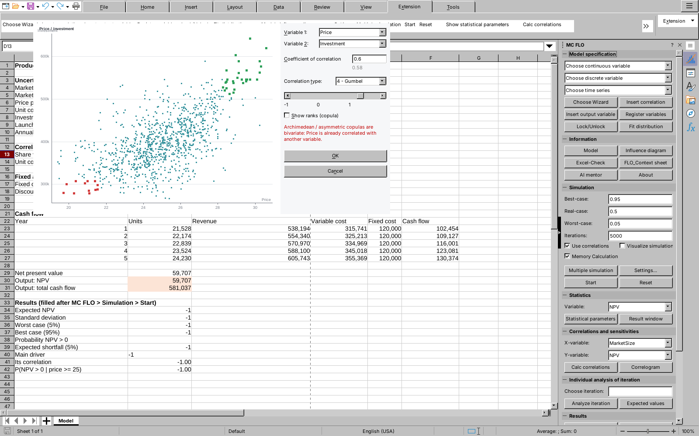

# MonteCalc — Monte Carlo simulation for LibreOffice Calc (MC FLO workflow)

MonteCalc is a LibreOffice Calc extension written in C++. It follows the *MC FLO* user guide
(July 2026) and the MC FLO wiki on [www.mcflosim.ch](https://www.mcflosim.ch/wiki/): the same
function names and argument order (`=FLOsimula_Triangular(10;16;13;"Umsatz_Kunde")`,
`fmc_Average("NPV";"Competition")`), correlation type codes, variable conventions
(`FLO_i_`, `FLO_c_`, `FLO_o_`, `FLO_r_`), ribbon groups and windows. Workbooks written for
MC FLO therefore calculate in MonteCalc.

It is an independent implementation written from the published guide and wiki. It contains no
MC FLO code and is not affiliated with MC FLOsim; "MC FLO" is named only to describe
compatibility.

## Quick start

```bash
make            # builds build/MonteCalc.oxt (needs the LibreOffice SDK)
make install    # unopkg add (run as a normal user)
```

Open `examples/business_case.ods` (also attached to every release). It is laid out like the MC
FLO examples: known parameters, uncertain parameters, correlations, a calculation block with
the years as columns, output variables, result functions (`fMC_Average("NPV";"Monopoly")`)
and a variant table for the multiple simulation (Competition / Monopoly / Hybrid); the
*Read me* sheet walks through the flow. MonteCalc adds the MC FLO ribbon to Calc in four places,
all running the same commands:

- the **MC FLO sidebar deck** (sidebar icon on the right, or *View → Sidebar*). It has one
  panel per ribbon group: *Model specification* (Choose continuous / discrete variable / time
  series, Choose Wizard, Insert correlation, Insert output variable, Register variables,
  Lock/Unlock, Fit distribution), *Information*, *Simulation* (Best-case, Real-case,
  Worst-case, Iterations, Use correlations, Visualize simulation, Multiple simulation, Start,
  Reset), *Statistics* (Variable, Show statistical parameters), *Correlations and
  sensitivities* (X-/Y-variable, Calc correlations), *Individual analysis of iteration*,
  *Results* (Close and save results) and *Other*;
- the **Extension** tab of the tabbed interface (*View → User Interface → Tabbed*);
- the **MC FLO** toolbar, with icons and text;
- the **MC FLO** menu, whose submenus follow the ribbon groups and include the distribution
  pickers.



1. **Choose continuous variable** (or the Wizard) picks a distribution. Read values off the
   draggable **magic stripe**, then *Save into the selected cell*: MonteCalc writes the MC FLO
   formula, e.g. `=FLOsimula_PERT(200000;350000;250000;"MarketSize")`. *Fit distribution*
   fits historical data instead (with a Q-Q plot of the selected fit).
2. **Insert correlation** opens the correlation window described in the guide:
   - pick Variable 1 and 2, the coefficient (type it, or use the slider) and the correlation
     type with the MC FLO codes (0 Normal, 1 Clayton, 2 rClayton, 3 Gumbel, 4 rGumbel,
     5 Student-t, 6 asy. Gumbel, 7 asy. Triangular, 8 asy. Frechet);
   - the scatter shows up to 1,000 points, coloured as in the wiki: both values beyond the 90%
     band green (upper) or red (lower), one value beyond it black, the rest blue; the resulting
     rank correlation appears in grey under the coefficient;
   - *OK* writes `=FLOsimula_correlation("Price";"Investment";0.6;3)`, names it `FLO_c_…` and
     colours it; duplicate pairs and the bivariate rule of Archimedean copulas are checked.

   **Insert output variable** writes `=B30+FLOsimula_output("NPV")`.
3. **Register variables** names unnamed inputs (from the label to the left) by inserting the
   name after the parameters, creates the `FLO_i_ / FLO_c_ / FLO_o_` named ranges and colours
   the cells. **Model** brings a changed model up to date: variables that were overwritten or
   deleted are removed and every reference to them is replaced by 0 (wiki "Umgang mit
   Variablen"), then the variables are listed.
4. Set **Iterations**, **Best/Real/Worst-case** and **Use correlations** in the Simulation
   panel (or *Settings…* for the seed and Memory Calculation), then **Start**.
5. Analyse in the result window, the result workbook (*Store results*), the `fmc_` functions,
   the influence diagram (**Variables**) or the AI mentor.

## What is implemented

**Model functions (`FLOsimula_`)**, with the wiki's names and argument order
`(parameters…; [Variable_name]; [Number]; [Min]; [Max]; [Round])`:
- continuous: `Uniform` (`Uniforme`), `Triangular`, `PERT` (Lower; Upper; Mode), `Normal`,
  `LogNormal` (Shift; Mean; StDeviation of the logarithm), `Beta`, `Gumbel`, `Gamma` and
  `Weibull` (Shift; scale; shape), `Exponential` (Shift; mean), `TruncNormal`, `chi2`,
  `studentt`, `Pareto`, `Fisher`, `ArcSin`, `Cauchy`, `Frechet`, `Logistic`, `UserDefined`
  (Data; NumberOfBins; Name, also histograms and quantile/probability pairs);
- discrete: `DiscreteUniform` (`DiscreteUniforme`), `Bernoulli`, `Binomial` (Probability;
  Tries), `Poisson`, `Pascal`, `Geometric`, `Hypergeometric` (Tries; Population;
  Success_Possibles), `DiscreteUserDefined`;
- time series: `TemporalS_ARmodel`, `_MAmodel`, `_ARMAmodel`, `_ARCHmodel`, `_WPmodel`. As in
  MC FLO the path continues from iteration to iteration ("5,000 iterations = 5,000 periods");
  `Number` = n starts every iteration at Start and returns period n; `UseBefore` = 1 starts at
  Start (typically the previous period's cell);
- `FLOsimula_Bounded(Variable; Lower; Upper; Name)` truncates a registered variable,
  `FLOsimula_output`, `FLOsimula_correlation`.

**Memory Calculation functions:** `_simula_<Distribution>_MC(parameters; [count])` (column
vectors, default 30,000 values), `_simula_calculation_MC` (+ - * / */+ */- //+ //- Max Min com
csme inc const), `_simula_correlation_MC`, `_simula_Bounded_MC`, and the `…_MC` variants of the
Bayes and regression functions. Besides these, *Memory Calculation* in the settings runs the
classic model through MonteCalc's in-memory formula engine.

**Correlations:** all nine types, each calibrated to the requested rank correlation.
Inconsistent matrices are repaired with a warning, and the rule that Archimedean copulas are
bivariate is enforced.

**Registration (as in the guide):**
- `FLO_i_` / `FLO_c_` / `FLO_o_` names and cell colours.
- Unnamed inputs such as `FLOsimula_DiscreteUniform(300;500)`.
- *Register variables*, *Show*, *Lock/Unlock* (red cells) and *Multiple
  simulation* (Variant / Value / Reference rows, grey cells).

**Simulation:**
- *Start*, *Reset*, the `# iterations` and *Seed* settings (seed −1 =
  preview mode), *Visualize simulation* and worst/real/best scenarios.
- **Memory Calculation**: an in-memory formula engine, about 5× faster on the
  test model, that falls back to spreadsheet recalculation when a function
  isn't supported.

**All windows** can be resized and maximised: the chart fills the window, the control column
stays on the right edge, long lists and the mentor's conversation grow with the window, and a
minimum size keeps every control visible. Charts are drawn off screen and copied in one step,
so nothing flickers while resizing; each kind of window reopens with the size and position it
had last. Zoom with Ctrl +/−/0 (starts at 125%). The sidebar panels stretch with the sidebar.

**Result window** (wiki "Output"):
- variant choice at the top (multiple simulation) and *Store results* (result workbook);
- histogram and cumulative curve with the magic stripe (drag it, or enter `x` or `;p`),
  worst/best markers and the **certainty level** (e.g. 95%) with its lower and upper limit;
- **correlation** of all inputs and outputs with the variable (Spearman), **dynamic
  sensitivity** (output range by input interval, expected value in orange) — click a bar for
  the regression scatter — and the **spider diagram** (Pearson by 10% quantile, isolated or
  cumulative);
- **variants** overlay and **Box-Whisker** (box 25–75%, whiskers 15–85%);
- **decision matrix**: target with direction (`>` result should exceed it, `<` stay below),
  ambition level, conditional probability that a driver breaches its ambition level when the
  target is missed against the conditional damage, drivers with |rank correlation| ≤ 0.05
  left out; the tooltip gives the driver range compatible with the target (P95);
- **overview**: select several variable cells before *Results* to see them at a glance;
- statistics grid, *Export image* and *Store as comment*.

**Result workbook:**
- Data (write-protected), Summary (scenarios, 5% steps, 1% extremes, ±3% around
  the real case), Statistics (histogram, cumulative curve, worst/best and
  0-limit, CI of the mean), Sensitivity (tornado) and Variants sheets.
- *Change histogram* (set bins).
- *Correlation and sensitivities*: an X/Y regression sheet whose new X goes in
  **I4**, giving the estimate in **I5** and the 95% forecast interval in
  **K5/L5**, plus correlation by 10% quantile of Y and LINEST output from
  **D52**.
- *Analyse selected iteration*, which writes an iteration's input values into
  the model and restores the formulas afterwards.
- *Close and save results* (`<model>_dd_mm_yyyy_hh_mm_ss_MC_FLO.ods`).

**Fitting and forecasting:**
- *Fit distribution*: least squares against the empirical CDF, with KS test,
  the AIC window, *prefer higher values* (beta) and *Insert formula into
  current cell*.
- *Fit time series*: AR / MA / ARMA / ARCH / Wiener ranked by AIC, Theil's U,
  a simulated path with forecast band, and a Holt-Winters comparison.
- *Forecast-Tool*, the `fMC_Batch_Time` / `fMC_Batch_HW_D/M/Q_Time` markers and
  *Start Batch*, which writes the estimated history plus forecasts and adds a
  comment with date and U-test.

**Result and tool functions (`fmc_`):** every function of the wiki's reference page, with its
argument order, including the optional variant argument `Referenz` of the result functions
(`fmc_CorrP("Volume";"NPV";"Competition")`), the reference's percentile rule (the
ROUNDUP(n·p)-th value), `fmc_Bayes4` conditions written as `">="&100`, `fMC_HWAmodel` /
`fMC_HWMmodel`, and the portfolio, Markov, kernel, bootstrap, Bayes and regression families.
All functions are listed in **[docs/FUNCTIONS.md](docs/FUNCTIONS.md)**.

**Other tools:** Sort asc/des, Excel-Check (a model check workbook covering
volatile and lookup functions, non-principal FLO formulas, constants in
formulas, empty references, unnamed inputs, duplicate names and unknown
correlation partners), Use DIP (`FLO_r_` arrays), Correlogram and Hide/Load
formulas.

**Influence diagram:**
- Nodes for inputs, relationships and outputs, with arrows derived from the
  formulas (traced through intermediate cells).
- Select, hover tooltip, drag with reflow, double-click to jump to the cell.
- Opened with **Variables** (as in MC FLO); inputs on the left, outputs on the right (process
  flow).
- Zoom (Ctrl +, Ctrl −, Ctrl 0, or the Zoom buttons); text, nodes, legend and arrows scale
  together, also in exported images.
- Context menu and the shortcuts F5, Ctrl+R/L/S/E/F/T/G/D/I/H/K/J, Ctrl+Shift+C,
  Ctrl+M and Ctrl +/−/0.
- Distributions inside nodes, sensitivity-weighted arrows, focus on selection,
  group view (`Event_1…n` → module), orthogonal arrows.
- Export as PNG/JPEG/BMP at twice screen resolution.
- Formula editor in Edit mode: move a reference by columns/rows, or retype the
  formula.
- A Results tab with overlaid histograms and cumulative curves, a probe and a
  statistics grid.

**FLO_Context sheet:** the guide's columns, with Depends On traced through
intermediate cells.

**AI mentor:**
- A chat window that sends Claude the model's structure and statistics (not the
  cells).
- Uses `claude-opus-5-5` through the Anthropic Messages API, with the
  server-side refusal fallback enabled.
- The API key is read from `Documents/MC_FLO_API.txt`.
- *Settings*: answer language (German, English, Spanish or the question's language) and your
  own instructions, stored in `Documents/MC_FLO_mentor.txt`.
- Distributions are sent compressed as histograms; Claude can look up MC FLO function syntax
  in the wiki with a `fetch_documentation` tool (www.mcflosim.ch pages only).
- Copy the conversation, or export it to HTML, Word or PDF.

## Where guide and wiki leave room: MonteCalc's choices

| Topic | MC FLO | MonteCalc |
|---|---|---|
| Options of the distributions | "Min, Max and discrete values can be declared" (positions not documented) | `(parameters; Name; Number; Min; Max; Round)` |
| AR / MA / ARMA "Start" | "constant (Start)" | level of the process: x = Start + Weight·(x₋₁ − Start) + ε (MA: Start + ε + Weight·ε₋₁) |
| Wiener process | `(Start; Drift; Mu; StDeviation; UseBefore)`, Drift = volatility | volatility = Drift·StDeviation; with four numbers StDeviation = 1 |
| Asymmetric copulas | named only | asy. Gumbel and asy. Triangular = Khoudraji asymmetrisations of Gumbel and Clayton; asy. Fréchet = Marshall–Olkin |
| Correlation coefficient | used as shape parameter | calibrated so that the rank correlation matches |
| `fmc_PercentileValue` | position of the value in the sorted list, 0..1 | (index of the first value ≥ x) / (n − 1) |
| `fMC_BayesPrediction` | Count, tolerable unsuccessful Attempts | negative-binomial predictive per posterior draw; values above Attempts are reported as Attempts+1 |
| `fMC_BayesMCMC*` | prior + "new data of the same type" | target density ∝ product of the two kernel-estimated densities |
| Bayesian regression | prior from a small subsample, bootstrap likelihood | Bayesian bootstrap (Dirichlet-weighted least squares) pooled over `kfolds` random subsets |
| `_simula_…_MC` default count | "30'00" | 30,000 |
| Decision matrix | conditional probability and damage | breach = driver beyond its own ambition quantile on the unfavourable side; damage = mean shortfall of the target in those iterations |
| Fit: "Degree of freedom", "increment" | grid for the fit | not used: all parameters are fitted by Nelder–Mead |
| Ribbon | an Excel ribbon tab "MC FLO" | LibreOffice extensions cannot add a ribbon tab of their own, so the ribbon groups become the MC FLO sidebar deck (with the input fields), the *Extension* tab of the tabbed interface (text buttons), a toolbar and a menu |
| Volatile `…V` functions | recalculate on every change | aliases (Calc recalculates dependent cells anyway). Deterministic data functions are cached on their arguments |

The guide's `fMC_GetOuputName` typo is kept as written; `fMC_GetOutputName` is provided too.
UNO IDL forbids identifiers that start with a lower-case letter and contain `_` (or start with
`_`), so the programmatic names are adjusted internally (`FMC_Average`, `Simula_Uniform_MC`);
Calc shows the MC FLO spelling and matches function names case-insensitively.

## Architecture

```
core/   C++17, no LibreOffice dependency (1442 unit-test checks)
        distributions, copulas, time series, statistics, fitting (Nelder-Mead, KS/AIC,
        Theil's U, Holt-Winters), Bayesian tools, flofuncs (FLOsimula_ semantics shared by
        the add-in and the memory engine), formula (parser/evaluator), simulation state
uno/    addin (132 functions, generated), engine (all commands), model (cell scanning,
        named ranges), report (result workbook), deps (variable dependencies), painter/
        charts/canvaswin (drawing, modeless windows), windows (result window, wizard,
        correlation window, fitting, correlogram, variable list, context), influence (diagram),
        mentor (Claude), sidebar (MC FLO deck: one panel per ribbon group)
tools/  gen_functions.py: one table generating IDL, C++, wizard metadata and docs
        gen_ui.py (+ gen_icons.py): one ribbon table generating the menu, toolbar, Notebookbar
        tab, sidebar deck registration and icons
tests/  core_tests.cpp, integration_test.py (headless LibreOffice, run as a normal user)
```

A run works in four steps:

1. **Register.** One recalculation registers the named inputs, outputs and
   correlations, and the engine scans the cells for `FLOsimula_` formulas.
2. **Prepare.** Correlated uniforms are generated per named input.
3. **Simulate.** Each iteration either recalculates Calc or evaluates the model
   in memory, then records the values of all input and output cells. That is
   why an MC FLO function must be the principal function of its cell, as the
   guide says.
4. **Finish.** The results are stored as a result set, one per variant.

## Building and testing

```bash
make && make test      # extension + core unit tests (Linux, Makefile)
cmake -S . -B build && cmake --build build && ctest --test-dir build   # any platform
make itest             # end-to-end test in headless LibreOffice (as a normal user)
```

Requirements: the LibreOffice SDK (`libreoffice-dev`), g++ ≥ 9, Python 3 and
zip. The AI mentor needs libcurl at run time; it is loaded on demand.

**Windows:** see **[docs/WINDOWS.md](docs/WINDOWS.md)** for installation and
building. `CMakeLists.txt` builds with Visual Studio against the official
LibreOffice SDK for Windows, and the GitHub Actions workflow
(`.github/workflows/build.yml`) produces `MonteCalc-windows_x86_64.oxt` and
`MonteCalc-linux_x86_64.oxt` on every push. On Windows the AI mentor uses
WinHTTP; elsewhere it loads libcurl at run time.
